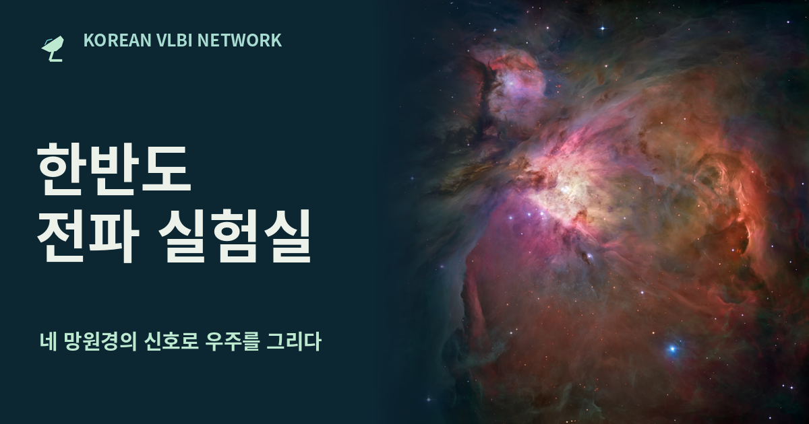

# KVN | 한반도 전파 실험실 (v8.2.0)

연세·울산·탐라·평창 네 곳의 **한국우주전파관측망(KVN, Korean VLBI Network)** 전파망원경 신호를 합성하여 **게성운(Crab Nebula)**과 **M87 은하의 제트(M87 Jet)** 영상을 복원하는 대화형 전파천문 가상 실험실입니다.

별도의 외부 라이브러리나 서버 설치 없이 단일 HTML 파일([`radio_telescope.html`](./radio_telescope.html) / [`index.html`](./index.html))만으로 브라우저에서 2차원 푸리에 변환(FFT/IFFT), UV 평면 샘플링, 파형 드래그 시계 동기화(자석 스냅 및 좌우 영상 병합), 배열 너비별 분해능 비교 및 CLEAN 영상 복원 과정을 직접 체험할 수 있습니다.

- **바로 체험하기 (GitHub Pages)**: [https://poeticecho.github.io/radiotelescope/](https://poeticecho.github.io/radiotelescope/)

---

## 주요 기능 및 실험 과정

### 1. 관측 천체 선택
- **게성운 (Crab Nebula, `05h 34m 32s · +22° 00′ 52″`)**: 초신성 폭발 잔해의 넓게 퍼진 전파 윤곽과 광학 구조 비교
- **M87의 제트 (M87 Jet, `12h 30m 49.4s · +12° 23′ 28″`)**: 거대타원은하 중심에서 뻗어 나오는 상대론적 제트의 매듭 구조 관측

### 2. 통합 인터랙티브 실험 환경
- 관측 주파수(`22` / `43` / `86` / `129 GHz`), 관측 지속 시간(지구 자전 합성), 대기 위상 보정, 관측소별 시계 지연(`ps`) 및 선형 위상 드리프트, CLEAN 반복 연산(`+1`, `+10`) 등 모든 전문 파라미터를 하나의 통합 실험 화면에서 직접 제어합니다.

### 3. 4단계 인터랙티브 실험
1. **01 전파 모으기 (포물면 반사와 초점 맞추기)**
   - 21m 전파망원경 접시 위에서 **수신기 초점 위치(`±25 mm`, `±4 mm` 자석 스냅)**를 마우스/손가락으로 직접 드래그하거나 **전파 입사각(`±12°`)**을 기울여 보며 반사 전파의 초점 수렴과 실시간 집광 효율(`%`) 변화를 실험합니다.
2. **02 시간 맞추기 (파형 드래그 동기화 · 자석 스냅 · 좌우 영상 병합)**
   - 중앙의 두 관측소 전파 파형 그래프를 **손가락이나 마우스로 직접 좌우로 밀어(드래그)** 시간축 오차를 맞춥니다.
   - **자석 효과(`🧲 ±5 ps`)**: 파형 드래그 또는 고정 시간 오차 슬라이더 조절 시 오차 범위(`±5 ps`) 이내에 들어오면 `0 ps`에 자석처럼 딱 달라붙어 동기화됩니다.
   - **좌우 천체 영상 실시간 병합**: 파형을 좌우로 흔들거나 이동하면 하단 병합 뷰어의 좌우 천체 영상(기준 관측소 A · 비교 관측소 B)이 실시간으로 이동하여 `0 ps`에서 하나의 선명한 간섭 영상으로 합쳐집니다.
3. **03 망원경 연결 (기선 가이드라인 일치 · 삼각형 배열 · 배열 너비와 분해능)**
   - **가이드라인 일치 패킷 이동**: 한반도 지도 위에서 전파 신호 점들이 점선 기선 가이드라인을 정확히 따라 왕복 이동하며, **1대만 가동할 때는 기선과 이동 점이 나타나지 않습니다.**
   - **탐라 제외 3대 삼각형 연결**: 제주 탐라를 끄면 연세·평창·울산 **3개 관측소가 삼각형 기선으로 서로 만나며**, 유효 배열 너비가 `504 km`에서 `305 km`로 줄어드는 모습을 지도와 가상 구경 원으로 즉시 확인합니다.
   - **배열 유효 너비 ↔ 분해능 실시간 시뮬레이터**: `4대 전체(504km)` vs `탐라 빼기(305km 삼각형)` vs `1대만(21m 단일경)`의 유효 구경 폭 차이가 합성 빔(PSF) 모양과 인접 쌍성(`mas`) 분해능 차이로 어떻게 나타나는지 실시간 프로파일로 비교하며, UV 평면 점 위에 커서를 올려 개별 기선 정보를 확인할 수 있습니다.
4. **04 영상 복원 (6단계 파이프라인)**
   - `1단계 첫 전파 영상`: 선택한 KVN 기선만으로 합성한 초기 영상(Dirty Image) 확인
   - `2단계 넓은 구조 보충`: 짧은 기선(저주파 공간 성분) 보조 표본 추가
   - `3단계 CLEAN 복원`: 합성 빔(PSF)으로 인한 가짜 무늬(사이드로브)를 줄이는 CLEAN 알고리즘 수행
   - `4단계 전파색 입히기`: 복원된 전파 밝기 분포에 의사 색상(False Color) 팔레트 적용
   - `5단계 광학 더하기`: 동일 천구 좌표의 광학 관측 사진과 전파 영상을 중첩하여 비교
   - `6단계 공개 영상 비교`: 내가 복원한 합성 영상과 실제 학술 공개 관측 영상을 나란히 비교

### 4. 부가 학습 자료 및 도구
- **실제 전파 관측 사례**: ALMA(`VY CMa`), VERA(`M87`, `W75N`), KVN(`3C 279`, `Cygnus X-3`) 실측 자료 및 Dirty ↔ CLEAN 슬라이더(Wipe) 비교
- **관측소 야간 사진 갤러리** 및 사용자 2×2 관측소 사진 업로드 적용 기능
- **관측 원리와 학술 출처 안내** 및 **6문항 확인 퀴즈**

---

## 파일 구성

| 파일명 | 설명 |
| :--- | :--- |
| [`index.html`](./index.html) / [`radio_telescope.html`](./radio_telescope.html) | 시뮬레이션 엔진(2D FFT/IFFT, UV 그리딩, CLEAN 복원), UI 스타일, 내장 이미지 데이터를 모두 포함한 단일 실행 웹 애플리케이션 (GitHub Pages 기본 진입점 포함) |
| [`og.png`](./og.png) | 오픈그래프(Open Graph) 미리보기용 대표 이미지 (`1200×630`) |
| [`favicon.ico`](./favicon.ico) | 브라우저 탭 아이콘 (Favicon) |

---

## 실행 방법

별도의 빌드 과정이나 서버 구성이 필요하지 않습니다.

1. 저장소의 파일들을 내려받습니다.
2. [`radio_telescope.html`](./radio_telescope.html) 파일을 최신 웹 브라우저(Chrome, Edge, Safari, Firefox 등)에서 바로 엽니다.
3. 데스크톱, 태블릿(iPad 등), 모바일 화면 크기에 맞춰 반응형 레이아웃으로 동작합니다.
